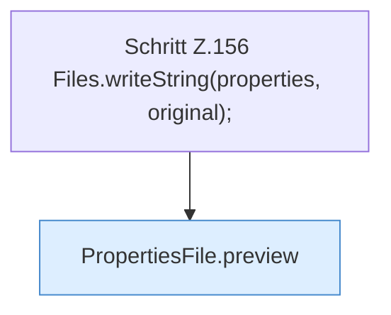

[[00 Start]] › [[Tests]] › [[HosterTest]] › [[HosterTest.Teil2]] › [[HosterTest.propertiesPreviewShowsStartupDiffWithoutWriting]] › [[HosterTest.propertiesPreviewShowsStartupDiffWithoutWriting.Teil1]]

# HosterTest.propertiesPreviewShowsStartupDiffWithoutWriting.Teil1



```knoten
Schritt Z.156 Files.writeString(properties, original);
  Zeile 156: schreibt Text in eine Datei. `Files.writeString(properties, original);`
PropertiesFile.preview
  Dieser Teil macht hier einen einzelnen Schritt. Eine Ebene tiefer steht er genauer. Zeigt die Vorschau `preview`.
```

> [!knoten]- Was die Blöcke tun
> - **Schritt Z.156 Files.writeString(properties, original);**: Zeile 156: schreibt Text in eine Datei. `Files.writeString(properties, original);`
> - **PropertiesFile.preview**: Dieser Teil macht hier einen einzelnen Schritt. Eine Ebene tiefer steht er genauer. Zeigt die Vorschau `preview`.

- Ein weiterer Abschnitt derselben Übersicht.
- Fortsetzung von `HosterTest.propertiesPreviewShowsStartupDiffWithoutWriting`.
