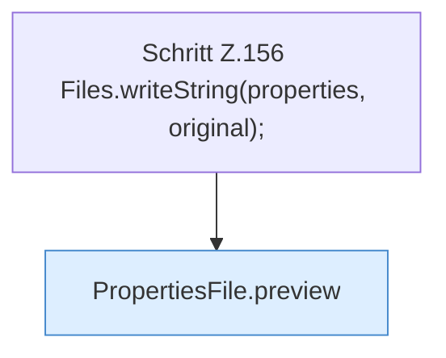

[[00 Start]] › [[Tests]] › [[HosterTest]] › [[HosterTest.Teil2]] › [[HosterTest.propertiesPreviewShowsStartupDiffWithoutWriting]] › [[HosterTest.propertiesPreviewShowsStartupDiffWithoutWriting.Teil1]]

# HosterTest.propertiesPreviewShowsStartupDiffWithoutWriting.Teil1



```knoten
Schritt Z.156 Files.writeString(properties, original);
  Zeile 156: schreibt Text in eine Datei. `Files.writeString(properties, original);`
PropertiesFile.preview
  Zeigt die Vorschau `preview`.
```

- Fortsetzung von `HosterTest.propertiesPreviewShowsStartupDiffWithoutWriting`, Quellreihenfolge.
