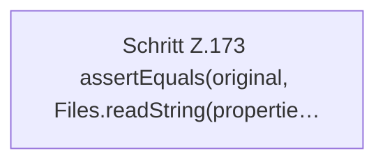

[[00 Start]] › [[Tests]] › [[HosterTest]] › [[HosterTest.Teil2]] › [[HosterTest.propertiesPreviewShowsStartupDiffWithoutWriting]] › [[HosterTest.propertiesPreviewShowsStartupDiffWithoutWriting.Teil2]]

# HosterTest.propertiesPreviewShowsStartupDiffWithoutWriting.Teil2



```knoten
Schritt Z.173 assertEquals(original, Files.readString(propertie…
  Zeile 173: liest Text aus einer Datei. `assertEquals(original, Files.readString(propertie…`
```

- Fortsetzung von `HosterTest.propertiesPreviewShowsStartupDiffWithoutWriting`, Quellreihenfolge.
