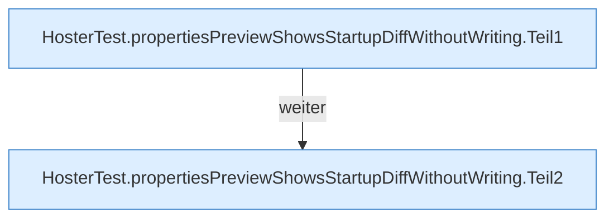

[[00 Start]] › [[Tests]] › [[HosterTest]] › [[HosterTest.Teil2]] › [[HosterTest.propertiesPreviewShowsStartupDiffWithoutWriting]]

# HosterTest.propertiesPreviewShowsStartupDiffWithoutWriting

`HosterTest.propertiesPreviewShowsStartupDiffWithoutWriting()` [src/test/java/de/aichele/childlauncher/HosterTest.java:153–174](https://github.com/Sciddie/minecraft-serverhoster-plugin/blob/95b02b953b0b4c23673e900e021a7c3c844aa37d/src/test/java/de/aichele/childlauncher/HosterTest.java#L153-L174)

- `propertiesPreviewShowsStartupDiffWithoutWriting` in `src/test/java/de/aichele/childlauncher/HosterTest.java`
- Auslöser: Test
