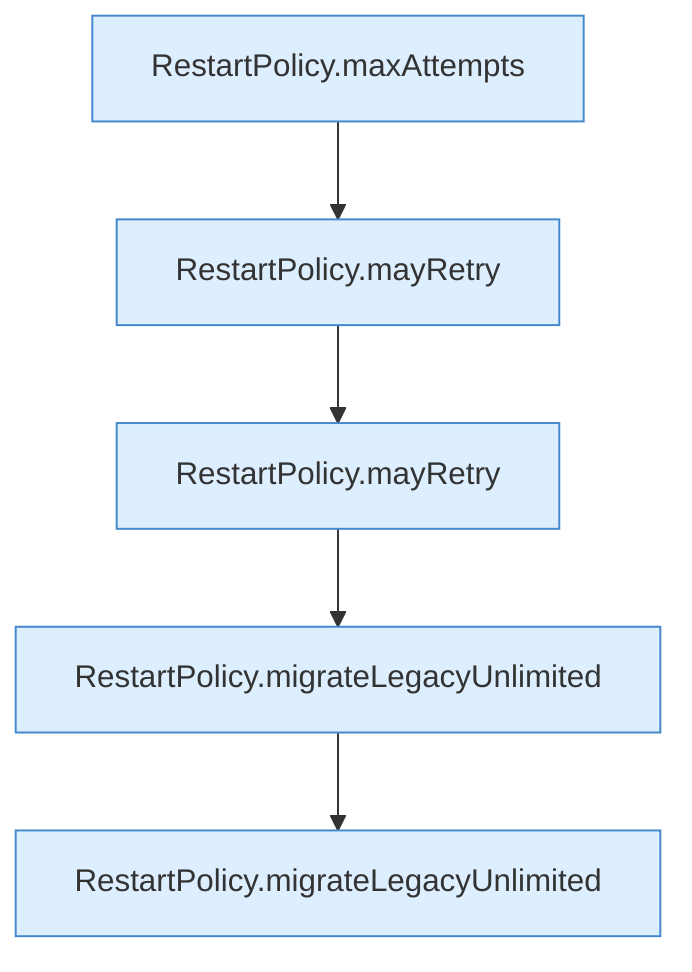

[[00 Start]] › [[Tests]] › [[HosterTest]] › [[HosterTest.Teil2]] › [[HosterTest.restartPolicyCapsRetriesAndMigratesOnlyTheOldUnlimitedDefault]] › [[HosterTest.restartPolicyCapsRetriesAndMigratesOnlyTheOldUnlimitedDefault.Teil1]]

# HosterTest.restartPolicyCapsRetriesAndMigratesOnlyTheOldUnlimitedDefault.Teil1



```knoten
RestartPolicy.maxAttempts
  Begrenzt nach oben `maxAttempts`.
RestartPolicy.mayRetry
  `mayRetry` in `RestartPolicy.java`.
RestartPolicy.migrateLegacyUnlimited
  Übernimmt den alten Wert von `migrateLegacyUnlimited`.
```

- Fortsetzung von `HosterTest.restartPolicyCapsRetriesAndMigratesOnlyTheOldUnlimitedDefault`, Quellreihenfolge.
