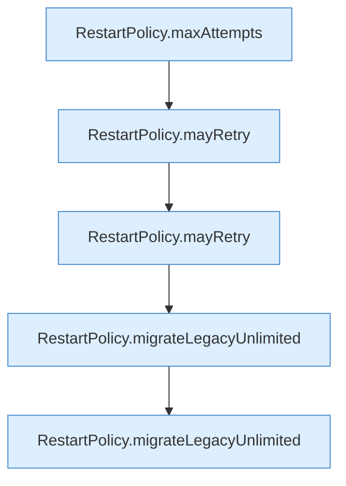

[[00 Start]] › [[Tests]] › [[HosterTest]] › [[HosterTest.Teil2]] › [[HosterTest.restartPolicyCapsRetriesAndMigratesOnlyTheOldUnlimitedDefault]] › [[HosterTest.restartPolicyCapsRetriesAndMigratesOnlyTheOldUnlimitedDefault.Teil1]]

# HosterTest.restartPolicyCapsRetriesAndMigratesOnlyTheOldUnlimitedDefault.Teil1



```knoten
RestartPolicy.maxAttempts
  Dieser Teil macht hier einen einzelnen Schritt. Eine Ebene tiefer steht er genauer. Begrenzt nach oben `maxAttempts`.
RestartPolicy.mayRetry
  Dieser Teil macht hier einen einzelnen Schritt. Eine Ebene tiefer steht er genauer. `mayRetry` in `RestartPolicy.java`.
RestartPolicy.migrateLegacyUnlimited
  Dieser Teil übernimmt den alten Wert von den alten Weg. Übernimmt den alten Wert von `migrateLegacyUnlimited`.
```

> [!knoten]- Was die Blöcke tun
> - **RestartPolicy.maxAttempts**: Dieser Teil macht hier einen einzelnen Schritt. Eine Ebene tiefer steht er genauer. Begrenzt nach oben `maxAttempts`.
> - **RestartPolicy.mayRetry**: Dieser Teil macht hier einen einzelnen Schritt. Eine Ebene tiefer steht er genauer. `mayRetry` in `RestartPolicy.java`.
> - **RestartPolicy.migrateLegacyUnlimited**: Dieser Teil übernimmt den alten Wert von den alten Weg. Übernimmt den alten Wert von `migrateLegacyUnlimited`.

- Ein weiterer Abschnitt derselben Übersicht.
- Fortsetzung von `HosterTest.restartPolicyCapsRetriesAndMigratesOnlyTheOldUnlimitedDefault`.
