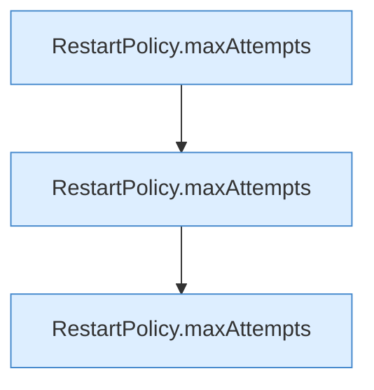

[[00 Start]] › [[Tests]] › [[HosterTest]] › [[HosterTest.Teil2]] › [[HosterTest.restartPolicyCapsRetriesAndMigratesOnlyTheOldUnlimitedDefault]] › [[HosterTest.restartPolicyCapsRetriesAndMigratesOnlyTheOldUnlimitedDefault.Teil2]]

# HosterTest.restartPolicyCapsRetriesAndMigratesOnlyTheOldUnlimitedDefault.Teil2



```knoten
RestartPolicy.maxAttempts
  Begrenzt nach oben `maxAttempts`.
```

- Fortsetzung von `HosterTest.restartPolicyCapsRetriesAndMigratesOnlyTheOldUnlimitedDefault`, Quellreihenfolge.
