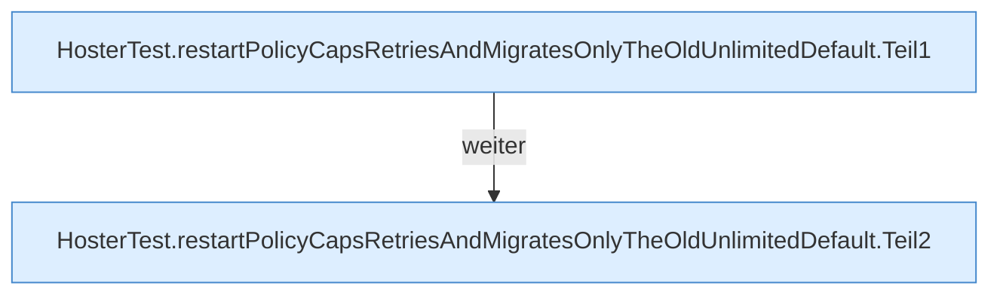

[[00 Start]] › [[Tests]] › [[HosterTest]] › [[HosterTest.Teil2]] › [[HosterTest.restartPolicyCapsRetriesAndMigratesOnlyTheOldUnlimitedDefault]]

# HosterTest.restartPolicyCapsRetriesAndMigratesOnlyTheOldUnlimitedDefault

`HosterTest.restartPolicyCapsRetriesAndMigratesOnlyTheOldUnlimitedDefault()` [src/test/java/de/aichele/childlauncher/HosterTest.java:284–294](https://github.com/Sciddie/minecraft-serverhoster-plugin/blob/95b02b953b0b4c23673e900e021a7c3c844aa37d/src/test/java/de/aichele/childlauncher/HosterTest.java#L284-L294)

- `restartPolicyCapsRetriesAndMigratesOnlyTheOldUnlimitedDefault` in `src/test/java/de/aichele/childlauncher/HosterTest.java`
- Auslöser: Test
