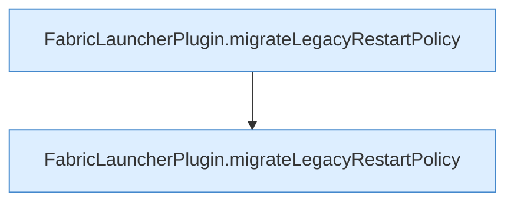

[[00 Start]] › [[Tests]] › [[HosterTest]] › [[HosterTest.Teil2]] › [[HosterTest.restartPolicyMigrationChangesOnlyThe2_0_0UnlimitedDefault]] › [[HosterTest.restartPolicyMigrationChangesOnlyThe2_0_0UnlimitedDefault.Teil1]]

# HosterTest.restartPolicyMigrationChangesOnlyThe2_0_0UnlimitedDefault.Teil1

- Fortsetzung von `HosterTest.restartPolicyMigrationChangesOnlyThe2_0_0UnlimitedDefault`, Quellreihenfolge.
