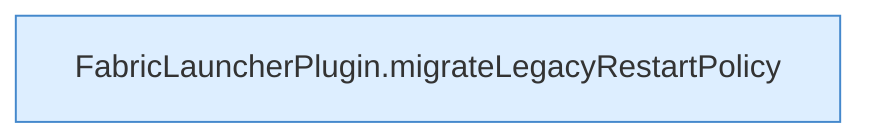

[[00 Start]] › [[Tests]] › [[HosterTest]] › [[HosterTest.Teil2]] › [[HosterTest.restartPolicyMigrationChangesOnlyThe2_0_0UnlimitedDefault]] › [[HosterTest.restartPolicyMigrationChangesOnlyThe2_0_0UnlimitedDefault.Teil2]]

# HosterTest.restartPolicyMigrationChangesOnlyThe2_0_0UnlimitedDefault.Teil2



```knoten
FabricLauncherPlugin.migrateLegacyRestartPolicy
  Dasselbe für eine noch ältere Schreibweise der [[Glossar#Neustart|Neustart]]-Regel. Übernimmt den alten Wert von `migrateLegacyRestartPolicy`. Ruft `migrateLegacyUnlimited`.
```

> [!knoten]- Was die Blöcke tun
> - **FabricLauncherPlugin.migrateLegacyRestartPolicy**: Dasselbe für eine noch ältere Schreibweise der [[Glossar#Neustart|Neustart]]-Regel. Übernimmt den alten Wert von `migrateLegacyRestartPolicy`. Ruft `migrateLegacyUnlimited`.

- Ein weiterer Abschnitt derselben Übersicht.
- Fortsetzung von `HosterTest.restartPolicyMigrationChangesOnlyThe2_0_0UnlimitedDefault`.
