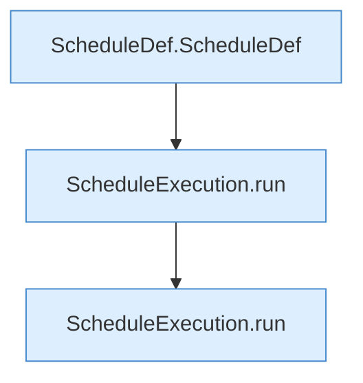

[[00 Start]] › [[Tests]] › [[HosterTest]] › [[HosterTest.Teil2]] › [[HosterTest.scheduleExecutionPreservesOrderAndStopsAfterFailure]] › [[HosterTest.scheduleExecutionPreservesOrderAndStopsAfterFailure.Teil1]]

# HosterTest.scheduleExecutionPreservesOrderAndStopsAfterFailure.Teil1

- Fortsetzung von `HosterTest.scheduleExecutionPreservesOrderAndStopsAfterFailure`, Quellreihenfolge.
