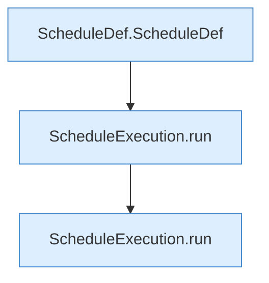

[[00 Start]] › [[Tests]] › [[HosterTest]] › [[HosterTest.Teil2]] › [[HosterTest.scheduleExecutionPreservesOrderAndStopsAfterFailure]] › [[HosterTest.scheduleExecutionPreservesOrderAndStopsAfterFailure.Teil1]]

# HosterTest.scheduleExecutionPreservesOrderAndStopsAfterFailure.Teil1



```knoten
ScheduleDef.ScheduleDef
  Der [[Glossar#Zeitplan|Zeitplan]] plant hier einen Schritt. Eine Ebene tiefer steht er genauer. Plant `ScheduleDef`. Ruft `validateInterval`.
ScheduleExecution.run
  Dieser Teil führt aus das. Führt aus `run`.
```

> [!knoten]- Was die Blöcke tun
> - **ScheduleDef.ScheduleDef**: Der [[Glossar#Zeitplan|Zeitplan]] plant hier einen Schritt. Eine Ebene tiefer steht er genauer. Plant `ScheduleDef`. Ruft `validateInterval`.
> - **ScheduleExecution.run**: Dieser Teil führt aus das. Führt aus `run`.

- Ein weiterer Abschnitt derselben Übersicht.
- Fortsetzung von `HosterTest.scheduleExecutionPreservesOrderAndStopsAfterFailure`.
