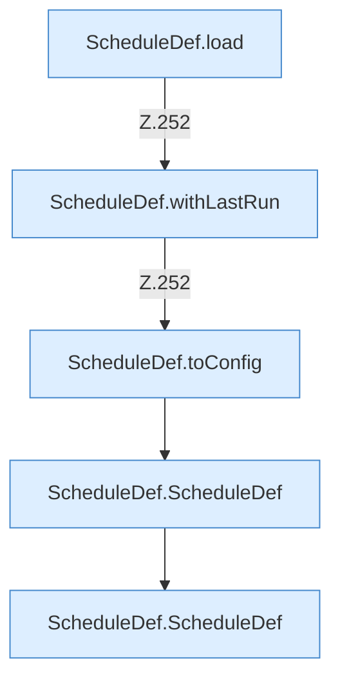

[[00 Start]] › [[Tests]] › [[HosterTest]] › [[HosterTest.Teil2]] › [[HosterTest.schedulesValidateVoxelDashIntervalsAndKeepOrderedActions]] › [[HosterTest.schedulesValidateVoxelDashIntervalsAndKeepOrderedActions.Teil2]]

# HosterTest.schedulesValidateVoxelDashIntervalsAndKeepOrderedActions.Teil2



```knoten
ScheduleDef.load
  Lädt `load`. Ruft `asMap`, `Action`, `string`.
ScheduleDef.withLastRun
  Liefert eine Kopie mit `withLastRun`. Ruft `ScheduleDef`.
ScheduleDef.toConfig
  `toConfig` in `ScheduleDef.java`. Ruft `toConfig`.
ScheduleDef.ScheduleDef
  Plant `ScheduleDef`. Ruft `validateInterval`.
```

- Fortsetzung von `HosterTest.schedulesValidateVoxelDashIntervalsAndKeepOrderedActions`, Quellreihenfolge.
