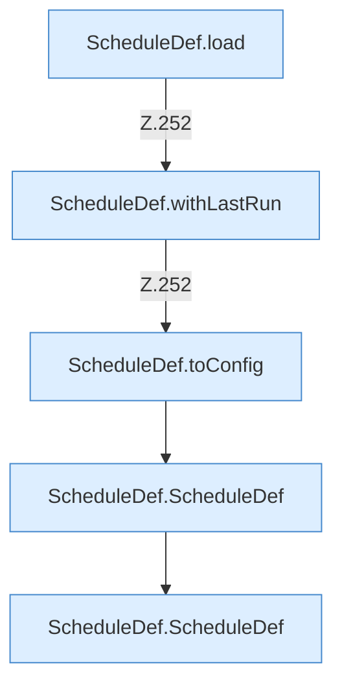

[[00 Start]] › [[Tests]] › [[HosterTest]] › [[HosterTest.Teil2]] › [[HosterTest.schedulesValidateVoxelDashIntervalsAndKeepOrderedActions]] › [[HosterTest.schedulesValidateVoxelDashIntervalsAndKeepOrderedActions.Teil2]]

# HosterTest.schedulesValidateVoxelDashIntervalsAndKeepOrderedActions.Teil2



```knoten
ScheduleDef.load
  Der [[Glossar#Zeitplan|Zeitplan]] lädt das. Lädt `load`. Ruft `asMap`, `Action`, `string`.
ScheduleDef.withLastRun
  Der [[Glossar#Zeitplan|Zeitplan]] kümmert sich um den letzten Stand den Lauf. Liefert eine Kopie mit `withLastRun`. Ruft `ScheduleDef`.
ScheduleDef.toConfig
  Der [[Glossar#Zeitplan|Zeitplan]] kümmert sich um die [[Glossar#Einstellungen|Einstellungen]]. `toConfig` in `ScheduleDef.java`. Ruft `toConfig`.
ScheduleDef.ScheduleDef
  Der [[Glossar#Zeitplan|Zeitplan]] plant hier einen Schritt. Eine Ebene tiefer steht er genauer. Plant `ScheduleDef`. Ruft `validateInterval`.
```

> [!knoten]- Was die Blöcke tun
> - **ScheduleDef.load**: Der [[Glossar#Zeitplan|Zeitplan]] lädt das. Lädt `load`. Ruft `asMap`, `Action`, `string`.
> - **ScheduleDef.withLastRun**: Der [[Glossar#Zeitplan|Zeitplan]] kümmert sich um den letzten Stand den Lauf. Liefert eine Kopie mit `withLastRun`. Ruft `ScheduleDef`.
> - **ScheduleDef.toConfig**: Der [[Glossar#Zeitplan|Zeitplan]] kümmert sich um die [[Glossar#Einstellungen|Einstellungen]]. `toConfig` in `ScheduleDef.java`. Ruft `toConfig`.
> - **ScheduleDef.ScheduleDef**: Der [[Glossar#Zeitplan|Zeitplan]] plant hier einen Schritt. Eine Ebene tiefer steht er genauer. Plant `ScheduleDef`. Ruft `validateInterval`.

- Ein weiterer Abschnitt derselben Übersicht.
- Fortsetzung von `HosterTest.schedulesValidateVoxelDashIntervalsAndKeepOrderedActions`.
