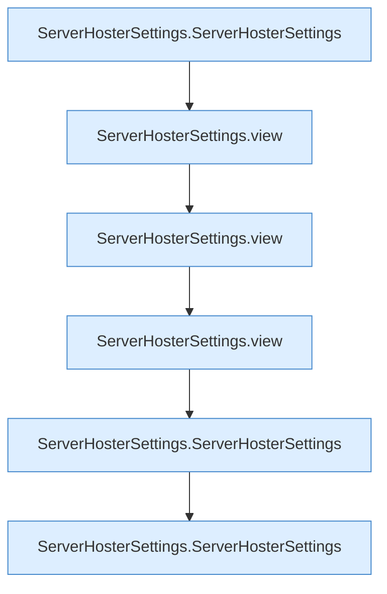

[[00 Start]] › [[Tests]] › [[HosterTest]] › [[HosterTest.Teil3]] › [[HosterTest.settingsValidateAndKeepRemoteCredentialsOutOfDashboardView]] › [[HosterTest.settingsValidateAndKeepRemoteCredentialsOutOfDashboardView.Teil1]]

# HosterTest.settingsValidateAndKeepRemoteCredentialsOutOfDashboardView.Teil1



```knoten
ServerHosterSettings.ServerHosterSettings
  Dieser Teil kümmert sich um das [[Glossar#Plugin|Plugin]] die [[Glossar#Einstellungen|Einstellungen]]. `ServerHosterSettings` in `ServerHosterSettings.java`. Ruft `maxAttempts`, `enumValue`, `hasUnsafeHostCharacter`.
ServerHosterSettings.view
  Dieser Teil macht hier einen einzelnen Schritt. Eine Ebene tiefer steht er genauer. Liefert die Sicht `view`.
```

> [!knoten]- Was die Blöcke tun
> - **ServerHosterSettings.ServerHosterSettings**: Dieser Teil kümmert sich um das [[Glossar#Plugin|Plugin]] die [[Glossar#Einstellungen|Einstellungen]]. `ServerHosterSettings` in `ServerHosterSettings.java`. Ruft `maxAttempts`, `enumValue`, `hasUnsafeHostCharacter`.
> - **ServerHosterSettings.view**: Dieser Teil macht hier einen einzelnen Schritt. Eine Ebene tiefer steht er genauer. Liefert die Sicht `view`.

- Ein weiterer Abschnitt derselben Übersicht.
- Fortsetzung von `HosterTest.settingsValidateAndKeepRemoteCredentialsOutOfDashboardView`.
