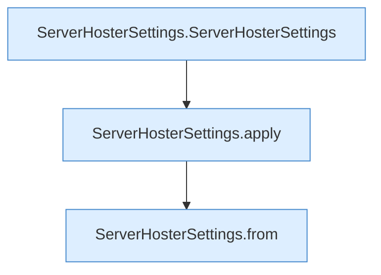

[[00 Start]] › [[Tests]] › [[HosterTest]] › [[HosterTest.Teil3]] › [[HosterTest.settingsValidateAndKeepRemoteCredentialsOutOfDashboardView]] › [[HosterTest.settingsValidateAndKeepRemoteCredentialsOutOfDashboardView.Teil2]]

# HosterTest.settingsValidateAndKeepRemoteCredentialsOutOfDashboardView.Teil2

- Fortsetzung von `HosterTest.settingsValidateAndKeepRemoteCredentialsOutOfDashboardView`, Quellreihenfolge.
