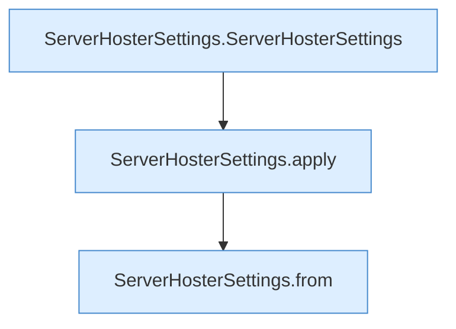

[[00 Start]] › [[Tests]] › [[HosterTest]] › [[HosterTest.Teil3]] › [[HosterTest.settingsValidateAndKeepRemoteCredentialsOutOfDashboardView]] › [[HosterTest.settingsValidateAndKeepRemoteCredentialsOutOfDashboardView.Teil2]]

# HosterTest.settingsValidateAndKeepRemoteCredentialsOutOfDashboardView.Teil2



```knoten
ServerHosterSettings.ServerHosterSettings
  Dieser Teil kümmert sich um das [[Glossar#Plugin|Plugin]] die [[Glossar#Einstellungen|Einstellungen]]. `ServerHosterSettings` in `ServerHosterSettings.java`. Ruft `maxAttempts`, `enumValue`, `hasUnsafeHostCharacter`.
ServerHosterSettings.apply
  Dieser Teil wendet an das. Wendet an `apply`.
ServerHosterSettings.from
  Dieser Teil macht hier einen einzelnen Schritt. Eine Ebene tiefer steht er genauer. `from` in `ServerHosterSettings.java`. Ruft `ServerHosterSettings`.
```

> [!knoten]- Was die Blöcke tun
> - **ServerHosterSettings.ServerHosterSettings**: Dieser Teil kümmert sich um das [[Glossar#Plugin|Plugin]] die [[Glossar#Einstellungen|Einstellungen]]. `ServerHosterSettings` in `ServerHosterSettings.java`. Ruft `maxAttempts`, `enumValue`, `hasUnsafeHostCharacter`.
> - **ServerHosterSettings.apply**: Dieser Teil wendet an das. Wendet an `apply`.
> - **ServerHosterSettings.from**: Dieser Teil macht hier einen einzelnen Schritt. Eine Ebene tiefer steht er genauer. `from` in `ServerHosterSettings.java`. Ruft `ServerHosterSettings`.

- Ein weiterer Abschnitt derselben Übersicht.
- Fortsetzung von `HosterTest.settingsValidateAndKeepRemoteCredentialsOutOfDashboardView`.
