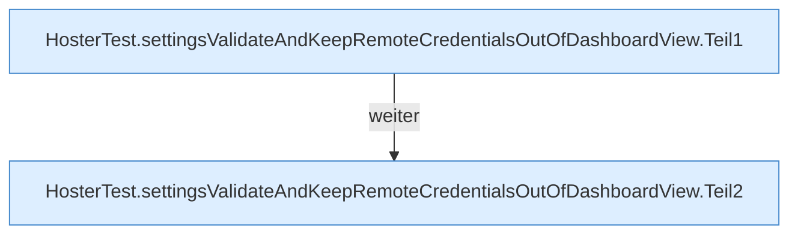

[[00 Start]] › [[Tests]] › [[HosterTest]] › [[HosterTest.Teil3]] › [[HosterTest.settingsValidateAndKeepRemoteCredentialsOutOfDashboardView]]

# HosterTest.settingsValidateAndKeepRemoteCredentialsOutOfDashboardView

`HosterTest.settingsValidateAndKeepRemoteCredentialsOutOfDashboardView()` [src/test/java/de/aichele/childlauncher/HosterTest.java:315–330](https://github.com/Sciddie/minecraft-serverhoster-plugin/blob/95b02b953b0b4c23673e900e021a7c3c844aa37d/src/test/java/de/aichele/childlauncher/HosterTest.java#L315-L330)

- `settingsValidateAndKeepRemoteCredentialsOutOfDashboardView` in `src/test/java/de/aichele/childlauncher/HosterTest.java`
- Auslöser: Test
