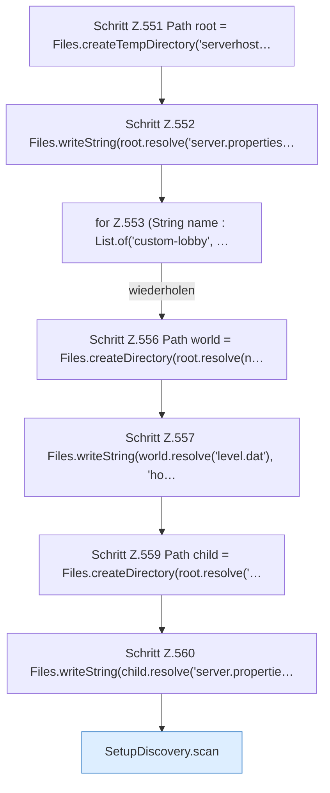

[[00 Start]] › [[Tests]] › [[HosterTest]] › [[HosterTest.Teil4]] › [[HosterTest.setupDiscoveryDoesNotOfferOuterWorldsAsChildServers]]

# HosterTest.setupDiscoveryDoesNotOfferOuterWorldsAsChildServers

`HosterTest.setupDiscoveryDoesNotOfferOuterWorldsAsChildServers()` [src/test/java/de/aichele/childlauncher/HosterTest.java:550–566](https://github.com/Sciddie/minecraft-serverhoster-plugin/blob/95b02b953b0b4c23673e900e021a7c3c844aa37d/src/test/java/de/aichele/childlauncher/HosterTest.java#L550-L566)



```knoten
Schritt Z.551 Path root = Files.createTempDirectory('serverhost…
  Zeile 551: Dateioperation. `Path root = Files.createTempDirectory('serverhost…`
Schritt Z.552 Files.writeString(root.resolve('server.properties…
  Zeile 552: schreibt Text in eine Datei. `Files.writeString(root.resolve('server.properties…`
for Z.553 (String name : List.of('custom-lobby', …
  Zeile 553: Schleife `(String name : List.of('custom-lobby', …`.
Schritt Z.556 Path world = Files.createDirectory(root.resolve(n…
  Zeile 556: Dateioperation. `Path world = Files.createDirectory(root.resolve(n…`
Schritt Z.557 Files.writeString(world.resolve('level.dat'), 'ho…
  Zeile 557: schreibt Text in eine Datei. `Files.writeString(world.resolve('level.dat'), 'ho…`
Schritt Z.559 Path child = Files.createDirectory(root.resolve('…
  Zeile 559: Dateioperation. `Path child = Files.createDirectory(root.resolve('…`
Schritt Z.560 Files.writeString(child.resolve('server.propertie…
  Zeile 560: schreibt Text in eine Datei. `Files.writeString(child.resolve('server.propertie…`
SetupDiscovery.scan
  Dieser Teil macht hier einen einzelnen Schritt. Eine Ebene tiefer steht er genauer. Durchsucht `scan`. Ruft `legacyPluginVersion`, `isAtLeast`, `loadLegacyConfig`.
```

> [!knoten]- Was die Blöcke tun
> - **Schritt Z.551 Path root = Files.createTempDirectory('serverhost…**: Zeile 551: Dateioperation. `Path root = Files.createTempDirectory('serverhost…`
> - **Schritt Z.552 Files.writeString(root.resolve('server.properties…**: Zeile 552: schreibt Text in eine Datei. `Files.writeString(root.resolve('server.properties…`
> - **for Z.553 (String name : List.of('custom-lobby', …**: Zeile 553: Schleife `(String name : List.of('custom-lobby', …`.
> - **Schritt Z.556 Path world = Files.createDirectory(root.resolve(n…**: Zeile 556: Dateioperation. `Path world = Files.createDirectory(root.resolve(n…`
> - **Schritt Z.557 Files.writeString(world.resolve('level.dat'), 'ho…**: Zeile 557: schreibt Text in eine Datei. `Files.writeString(world.resolve('level.dat'), 'ho…`
> - **Schritt Z.559 Path child = Files.createDirectory(root.resolve('…**: Zeile 559: Dateioperation. `Path child = Files.createDirectory(root.resolve('…`
> - **Schritt Z.560 Files.writeString(child.resolve('server.propertie…**: Zeile 560: schreibt Text in eine Datei. `Files.writeString(child.resolve('server.propertie…`
> - **SetupDiscovery.scan**: Dieser Teil macht hier einen einzelnen Schritt. Eine Ebene tiefer steht er genauer. Durchsucht `scan`. Ruft `legacyPluginVersion`, `isAtLeast`, `loadLegacyConfig`.

- Ein Schritt in einem [[Glossar#Probelauf|Probelauf]]. Er gehört nicht zum laufenden Server.
- `setupDiscoveryDoesNotOfferOuterWorldsAsChildServers` in `src/test/java/de/aichele/childlauncher/HosterTest.java`
- Das ist ein Probelauf, kein Teil des laufenden Servers.
