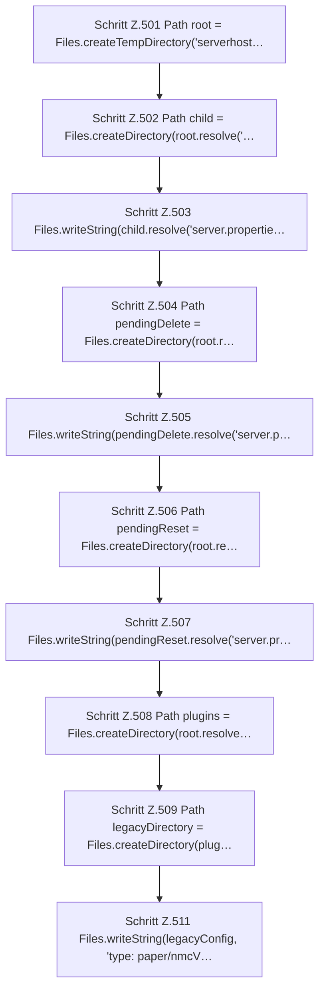

[[00 Start]] › [[Tests]] › [[HosterTest]] › [[HosterTest.Teil4]] › [[HosterTest.setupDiscoveryFindsExistingChildAndReadsLegacyConfiguration]] › [[HosterTest.setupDiscoveryFindsExistingChildAndReadsLegacyConfiguration.Teil1]]

# HosterTest.setupDiscoveryFindsExistingChildAndReadsLegacyConfiguration.Teil1



```knoten
Schritt Z.501 Path root = Files.createTempDirectory('serverhost…
  Zeile 501: Dateioperation. `Path root = Files.createTempDirectory('serverhost…`
Schritt Z.502 Path child = Files.createDirectory(root.resolve('…
  Zeile 502: Dateioperation. `Path child = Files.createDirectory(root.resolve('…`
Schritt Z.503 Files.writeString(child.resolve('server.propertie…
  Zeile 503: schreibt Text in eine Datei. `Files.writeString(child.resolve('server.propertie…`
Schritt Z.504 Path pendingDelete = Files.createDirectory(root.r…
  Zeile 504: Dateioperation. `Path pendingDelete = Files.createDirectory(root.r…`
Schritt Z.505 Files.writeString(pendingDelete.resolve('server.p…
  Zeile 505: schreibt Text in eine Datei. `Files.writeString(pendingDelete.resolve('server.p…`
Schritt Z.506 Path pendingReset = Files.createDirectory(root.re…
  Zeile 506: Dateioperation. `Path pendingReset = Files.createDirectory(root.re…`
Schritt Z.507 Files.writeString(pendingReset.resolve('server.pr…
  Zeile 507: schreibt Text in eine Datei. `Files.writeString(pendingReset.resolve('server.pr…`
Schritt Z.508 Path plugins = Files.createDirectory(root.resolve…
  Zeile 508: Dateioperation. `Path plugins = Files.createDirectory(root.resolve…`
Schritt Z.509 Path legacyDirectory = Files.createDirectory(plug…
  Zeile 509: Dateioperation. `Path legacyDirectory = Files.createDirectory(plug…`
Schritt Z.511 Files.writeString(legacyConfig, 'type: paper/nmcV…
  Zeile 511: schreibt Text in eine Datei. `Files.writeString(legacyConfig, 'type: paper/nmcV…`
```

> [!knoten]- Was die Blöcke tun
> - **Schritt Z.501 Path root = Files.createTempDirectory('serverhost…**: Zeile 501: Dateioperation. `Path root = Files.createTempDirectory('serverhost…`
> - **Schritt Z.502 Path child = Files.createDirectory(root.resolve('…**: Zeile 502: Dateioperation. `Path child = Files.createDirectory(root.resolve('…`
> - **Schritt Z.503 Files.writeString(child.resolve('server.propertie…**: Zeile 503: schreibt Text in eine Datei. `Files.writeString(child.resolve('server.propertie…`
> - **Schritt Z.504 Path pendingDelete = Files.createDirectory(root.r…**: Zeile 504: Dateioperation. `Path pendingDelete = Files.createDirectory(root.r…`
> - **Schritt Z.505 Files.writeString(pendingDelete.resolve('server.p…**: Zeile 505: schreibt Text in eine Datei. `Files.writeString(pendingDelete.resolve('server.p…`
> - **Schritt Z.506 Path pendingReset = Files.createDirectory(root.re…**: Zeile 506: Dateioperation. `Path pendingReset = Files.createDirectory(root.re…`
> - **Schritt Z.507 Files.writeString(pendingReset.resolve('server.pr…**: Zeile 507: schreibt Text in eine Datei. `Files.writeString(pendingReset.resolve('server.pr…`
> - **Schritt Z.508 Path plugins = Files.createDirectory(root.resolve…**: Zeile 508: Dateioperation. `Path plugins = Files.createDirectory(root.resolve…`
> - **Schritt Z.509 Path legacyDirectory = Files.createDirectory(plug…**: Zeile 509: Dateioperation. `Path legacyDirectory = Files.createDirectory(plug…`
> - **Schritt Z.511 Files.writeString(legacyConfig, 'type: paper/nmcV…**: Zeile 511: schreibt Text in eine Datei. `Files.writeString(legacyConfig, 'type: paper/nmcV…`

- Ein weiterer Abschnitt derselben Übersicht.
- Fortsetzung von `HosterTest.setupDiscoveryFindsExistingChildAndReadsLegacyConfiguration`.
