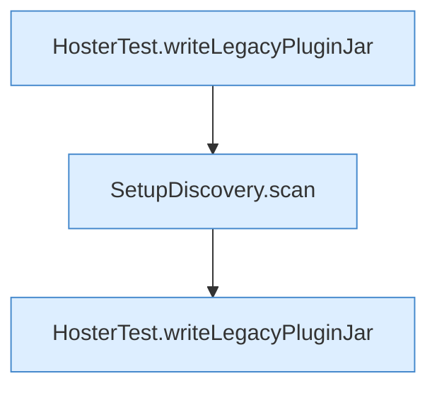

[[00 Start]] › [[Tests]] › [[HosterTest]] › [[HosterTest.Teil4]] › [[HosterTest.setupDiscoveryFindsExistingChildAndReadsLegacyConfiguration]] › [[HosterTest.setupDiscoveryFindsExistingChildAndReadsLegacyConfiguration.Teil2]]

# HosterTest.setupDiscoveryFindsExistingChildAndReadsLegacyConfiguration.Teil2

- Fortsetzung von `HosterTest.setupDiscoveryFindsExistingChildAndReadsLegacyConfiguration`, Quellreihenfolge.
