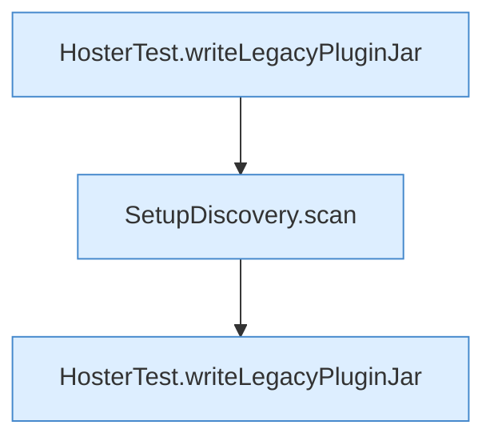

[[00 Start]] › [[Tests]] › [[HosterTest]] › [[HosterTest.Teil4]] › [[HosterTest.setupDiscoveryFindsExistingChildAndReadsLegacyConfiguration]] › [[HosterTest.setupDiscoveryFindsExistingChildAndReadsLegacyConfiguration.Teil2]]

# HosterTest.setupDiscoveryFindsExistingChildAndReadsLegacyConfiguration.Teil2



```knoten
HosterTest.writeLegacyPluginJar
  Ein Schritt in einem [[Glossar#Probelauf|Probelauf]]. Er gehört nicht zum laufenden Server. Schreibt `writeLegacyPluginJar`. Nur Test.
SetupDiscovery.scan
  Dieser Teil macht hier einen einzelnen Schritt. Eine Ebene tiefer steht er genauer. Durchsucht `scan`. Ruft `legacyPluginVersion`, `isAtLeast`, `loadLegacyConfig`.
```

> [!knoten]- Was die Blöcke tun
> - **HosterTest.writeLegacyPluginJar**: Ein Schritt in einem [[Glossar#Probelauf|Probelauf]]. Er gehört nicht zum laufenden Server. Schreibt `writeLegacyPluginJar`. Nur Test.
> - **SetupDiscovery.scan**: Dieser Teil macht hier einen einzelnen Schritt. Eine Ebene tiefer steht er genauer. Durchsucht `scan`. Ruft `legacyPluginVersion`, `isAtLeast`, `loadLegacyConfig`.

- Ein weiterer Abschnitt derselben Übersicht.
- Fortsetzung von `HosterTest.setupDiscoveryFindsExistingChildAndReadsLegacyConfiguration`.
