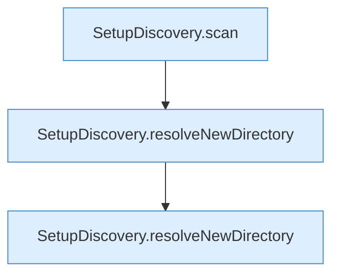

[[00 Start]] › [[Tests]] › [[HosterTest]] › [[HosterTest.Teil4]] › [[HosterTest.setupDiscoveryFindsExistingChildAndReadsLegacyConfiguration]] › [[HosterTest.setupDiscoveryFindsExistingChildAndReadsLegacyConfiguration.Teil3]]

# HosterTest.setupDiscoveryFindsExistingChildAndReadsLegacyConfiguration.Teil3



```knoten
SetupDiscovery.scan
  Dieser Teil macht hier einen einzelnen Schritt. Eine Ebene tiefer steht er genauer. Durchsucht `scan`. Ruft `legacyPluginVersion`, `isAtLeast`, `loadLegacyConfig`.
SetupDiscovery.resolveNewDirectory
  Dieser Teil bestimmt hier einen Schritt. Eine Ebene tiefer steht er genauer. Löst auf `resolveNewDirectory`.
```

> [!knoten]- Was die Blöcke tun
> - **SetupDiscovery.scan**: Dieser Teil macht hier einen einzelnen Schritt. Eine Ebene tiefer steht er genauer. Durchsucht `scan`. Ruft `legacyPluginVersion`, `isAtLeast`, `loadLegacyConfig`.
> - **SetupDiscovery.resolveNewDirectory**: Dieser Teil bestimmt hier einen Schritt. Eine Ebene tiefer steht er genauer. Löst auf `resolveNewDirectory`.

- Ein weiterer Abschnitt derselben Übersicht.
- Fortsetzung von `HosterTest.setupDiscoveryFindsExistingChildAndReadsLegacyConfiguration`.
