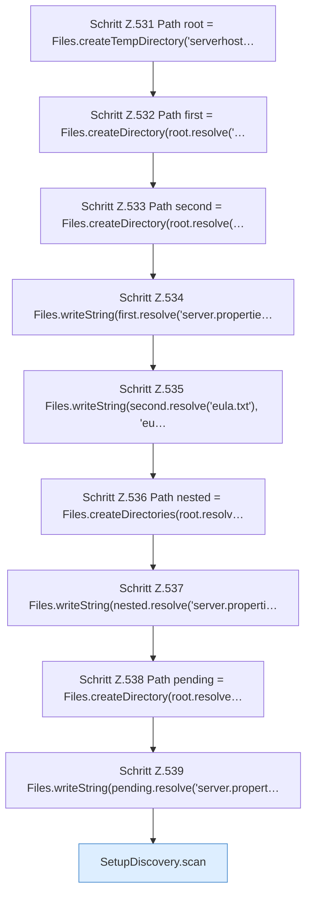

[[00 Start]] › [[Tests]] › [[HosterTest]] › [[HosterTest.Teil4]] › [[HosterTest.setupDiscoveryReportsAmbiguousDirectChildrenWithoutLegacyData]] › [[HosterTest.setupDiscoveryReportsAmbiguousDirectChildrenWithoutLegacyData.Teil1]]

# HosterTest.setupDiscoveryReportsAmbiguousDirectChildrenWithoutLegacyData.Teil1

- Fortsetzung von `HosterTest.setupDiscoveryReportsAmbiguousDirectChildrenWithoutLegacyData`, Quellreihenfolge.
