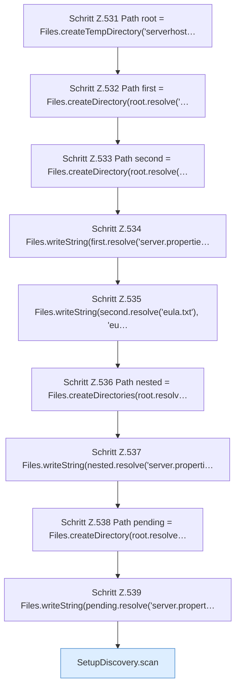

[[00 Start]] › [[Tests]] › [[HosterTest]] › [[HosterTest.Teil4]] › [[HosterTest.setupDiscoveryReportsAmbiguousDirectChildrenWithoutLegacyData]] › [[HosterTest.setupDiscoveryReportsAmbiguousDirectChildrenWithoutLegacyData.Teil1]]

# HosterTest.setupDiscoveryReportsAmbiguousDirectChildrenWithoutLegacyData.Teil1



```knoten
Schritt Z.531 Path root = Files.createTempDirectory('serverhost…
  Zeile 531: Dateioperation. `Path root = Files.createTempDirectory('serverhost…`
Schritt Z.532 Path first = Files.createDirectory(root.resolve('…
  Zeile 532: Dateioperation. `Path first = Files.createDirectory(root.resolve('…`
Schritt Z.533 Path second = Files.createDirectory(root.resolve(…
  Zeile 533: Dateioperation. `Path second = Files.createDirectory(root.resolve(…`
Schritt Z.534 Files.writeString(first.resolve('server.propertie…
  Zeile 534: schreibt Text in eine Datei. `Files.writeString(first.resolve('server.propertie…`
Schritt Z.535 Files.writeString(second.resolve('eula.txt'), 'eu…
  Zeile 535: schreibt Text in eine Datei. `Files.writeString(second.resolve('eula.txt'), 'eu…`
Schritt Z.536 Path nested = Files.createDirectories(root.resolv…
  Zeile 536: Dateioperation. `Path nested = Files.createDirectories(root.resolv…`
Schritt Z.537 Files.writeString(nested.resolve('server.properti…
  Zeile 537: schreibt Text in eine Datei. `Files.writeString(nested.resolve('server.properti…`
Schritt Z.538 Path pending = Files.createDirectory(root.resolve…
  Zeile 538: Dateioperation. `Path pending = Files.createDirectory(root.resolve…`
Schritt Z.539 Files.writeString(pending.resolve('server.propert…
  Zeile 539: schreibt Text in eine Datei. `Files.writeString(pending.resolve('server.propert…`
SetupDiscovery.scan
  Durchsucht `scan`. Ruft `legacyPluginVersion`, `isAtLeast`, `loadLegacyConfig`.
```

- Fortsetzung von `HosterTest.setupDiscoveryReportsAmbiguousDirectChildrenWithoutLegacyData`, Quellreihenfolge.
