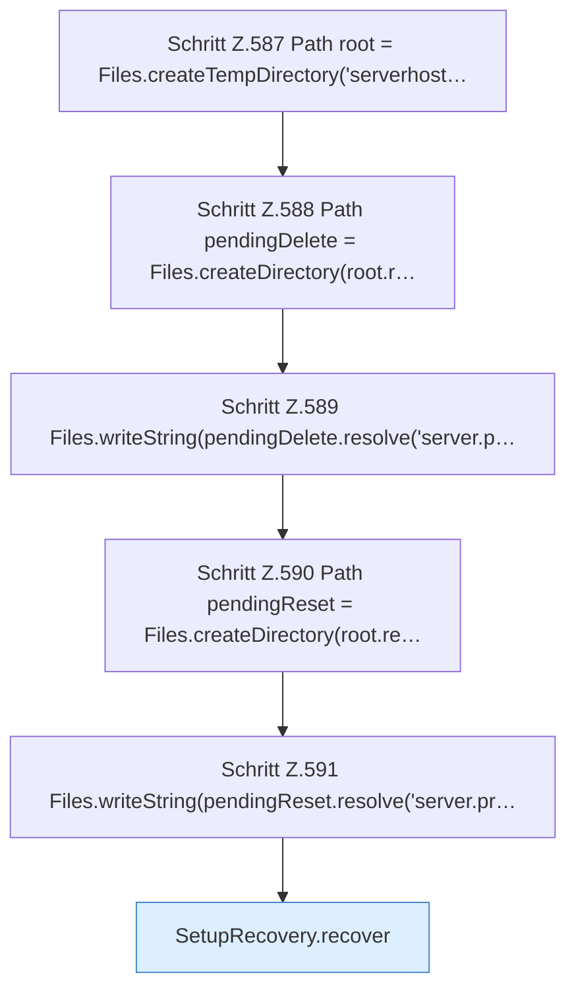

[[00 Start]] › [[Tests]] › [[HosterTest]] › [[HosterTest.Teil4]] › [[HosterTest.setupRecoveryFinishesOnlyConfirmedDeleteAndArchivesReset]] › [[HosterTest.setupRecoveryFinishesOnlyConfirmedDeleteAndArchivesReset.Teil1]]

# HosterTest.setupRecoveryFinishesOnlyConfirmedDeleteAndArchivesReset.Teil1



```knoten
Schritt Z.587 Path root = Files.createTempDirectory('serverhost…
  Zeile 587: Dateioperation. `Path root = Files.createTempDirectory('serverhost…`
Schritt Z.588 Path pendingDelete = Files.createDirectory(root.r…
  Zeile 588: Dateioperation. `Path pendingDelete = Files.createDirectory(root.r…`
Schritt Z.589 Files.writeString(pendingDelete.resolve('server.p…
  Zeile 589: schreibt Text in eine Datei. `Files.writeString(pendingDelete.resolve('server.p…`
Schritt Z.590 Path pendingReset = Files.createDirectory(root.re…
  Zeile 590: Dateioperation. `Path pendingReset = Files.createDirectory(root.re…`
Schritt Z.591 Files.writeString(pendingReset.resolve('server.pr…
  Zeile 591: schreibt Text in eine Datei. `Files.writeString(pendingReset.resolve('server.pr…`
SetupRecovery.recover
  Dieser Teil rückt wieder gerade das. Hebt hängende Zustände auf `recover`.
```

> [!knoten]- Was die Blöcke tun
> - **Schritt Z.587 Path root = Files.createTempDirectory('serverhost…**: Zeile 587: Dateioperation. `Path root = Files.createTempDirectory('serverhost…`
> - **Schritt Z.588 Path pendingDelete = Files.createDirectory(root.r…**: Zeile 588: Dateioperation. `Path pendingDelete = Files.createDirectory(root.r…`
> - **Schritt Z.589 Files.writeString(pendingDelete.resolve('server.p…**: Zeile 589: schreibt Text in eine Datei. `Files.writeString(pendingDelete.resolve('server.p…`
> - **Schritt Z.590 Path pendingReset = Files.createDirectory(root.re…**: Zeile 590: Dateioperation. `Path pendingReset = Files.createDirectory(root.re…`
> - **Schritt Z.591 Files.writeString(pendingReset.resolve('server.pr…**: Zeile 591: schreibt Text in eine Datei. `Files.writeString(pendingReset.resolve('server.pr…`
> - **SetupRecovery.recover**: Dieser Teil rückt wieder gerade das. Hebt hängende Zustände auf `recover`.

- Ein weiterer Abschnitt derselben Übersicht.
- Fortsetzung von `HosterTest.setupRecoveryFinishesOnlyConfirmedDeleteAndArchivesReset`.
