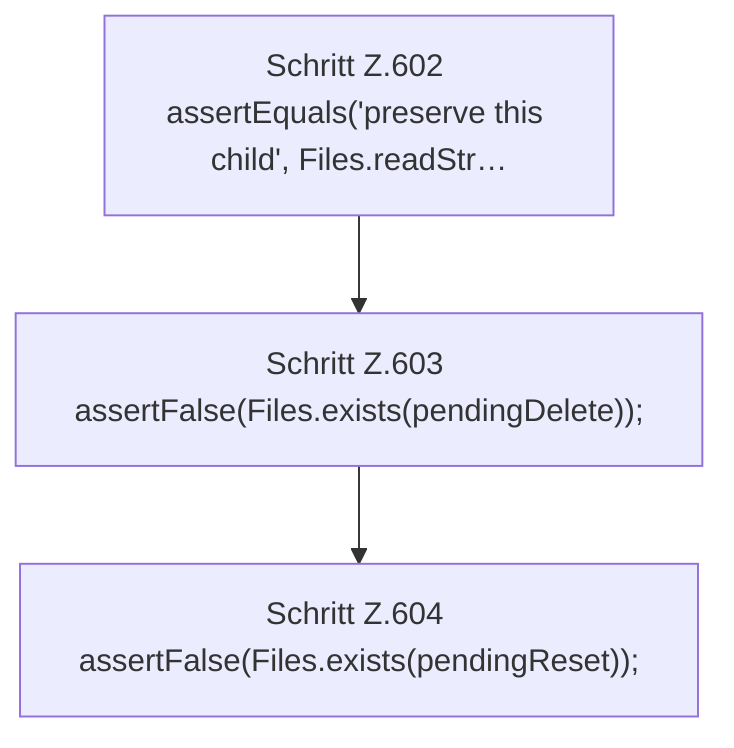

[[00 Start]] › [[Tests]] › [[HosterTest]] › [[HosterTest.Teil4]] › [[HosterTest.setupRecoveryFinishesOnlyConfirmedDeleteAndArchivesReset]] › [[HosterTest.setupRecoveryFinishesOnlyConfirmedDeleteAndArchivesReset.Teil2]]

# HosterTest.setupRecoveryFinishesOnlyConfirmedDeleteAndArchivesReset.Teil2



```knoten
Schritt Z.602 assertEquals('preserve this child', Files.readStr…
  Zeile 602: Dateioperation. `assertEquals('preserve this child', Files.readStr…`
Schritt Z.603 assertFalse(Files.exists(pendingDelete));
  Zeile 603: Dateioperation. `assertFalse(Files.exists(pendingDelete));`
Schritt Z.604 assertFalse(Files.exists(pendingReset));
  Zeile 604: Dateioperation. `assertFalse(Files.exists(pendingReset));`
```

> [!knoten]- Was die Blöcke tun
> - **Schritt Z.602 assertEquals('preserve this child', Files.readStr…**: Zeile 602: Dateioperation. `assertEquals('preserve this child', Files.readStr…`
> - **Schritt Z.603 assertFalse(Files.exists(pendingDelete));**: Zeile 603: Dateioperation. `assertFalse(Files.exists(pendingDelete));`
> - **Schritt Z.604 assertFalse(Files.exists(pendingReset));**: Zeile 604: Dateioperation. `assertFalse(Files.exists(pendingReset));`

- Ein weiterer Abschnitt derselben Übersicht.
- Fortsetzung von `HosterTest.setupRecoveryFinishesOnlyConfirmedDeleteAndArchivesReset`.
