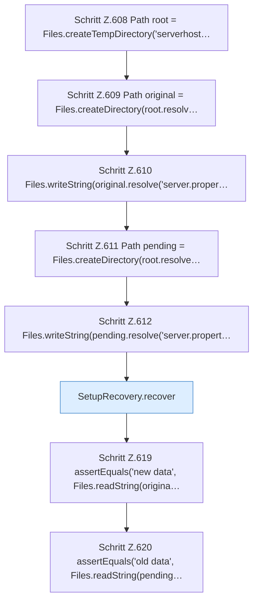

[[00 Start]] › [[Tests]] › [[HosterTest]] › [[HosterTest.Teil4]] › [[HosterTest.setupRecoveryPreservesPendingDataWhenDestinationCollides]]

# HosterTest.setupRecoveryPreservesPendingDataWhenDestinationCollides

`HosterTest.setupRecoveryPreservesPendingDataWhenDestinationCollides()` [src/test/java/de/aichele/childlauncher/HosterTest.java:607–621](https://github.com/Sciddie/minecraft-serverhoster-plugin/blob/95b02b953b0b4c23673e900e021a7c3c844aa37d/src/test/java/de/aichele/childlauncher/HosterTest.java#L607-L621)



```knoten
Schritt Z.608 Path root = Files.createTempDirectory('serverhost…
  Zeile 608: Dateioperation. `Path root = Files.createTempDirectory('serverhost…`
Schritt Z.609 Path original = Files.createDirectory(root.resolv…
  Zeile 609: Dateioperation. `Path original = Files.createDirectory(root.resolv…`
Schritt Z.610 Files.writeString(original.resolve('server.proper…
  Zeile 610: schreibt Text in eine Datei. `Files.writeString(original.resolve('server.proper…`
Schritt Z.611 Path pending = Files.createDirectory(root.resolve…
  Zeile 611: Dateioperation. `Path pending = Files.createDirectory(root.resolve…`
Schritt Z.612 Files.writeString(pending.resolve('server.propert…
  Zeile 612: schreibt Text in eine Datei. `Files.writeString(pending.resolve('server.propert…`
SetupRecovery.recover
  Hebt hängende Zustände auf `recover`.
Schritt Z.619 assertEquals('new data', Files.readString(origina…
  Zeile 619: liest Text aus einer Datei. `assertEquals('new data', Files.readString(origina…`
Schritt Z.620 assertEquals('old data', Files.readString(pending…
  Zeile 620: liest Text aus einer Datei. `assertEquals('old data', Files.readString(pending…`
```

- `setupRecoveryPreservesPendingDataWhenDestinationCollides` in `src/test/java/de/aichele/childlauncher/HosterTest.java`
- Auslöser: Test
