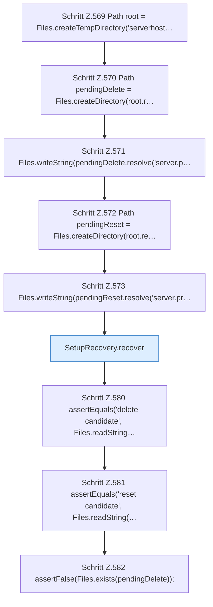

[[00 Start]] › [[Tests]] › [[HosterTest]] › [[HosterTest.Teil4]] › [[HosterTest.setupRecoveryRollsBackPendingDirectoriesBeforeSetupCompletes]] › [[HosterTest.setupRecoveryRollsBackPendingDirectoriesBeforeSetupCompletes.Teil1]]

# HosterTest.setupRecoveryRollsBackPendingDirectoriesBeforeSetupCompletes.Teil1

- Fortsetzung von `HosterTest.setupRecoveryRollsBackPendingDirectoriesBeforeSetupCompletes`, Quellreihenfolge.
