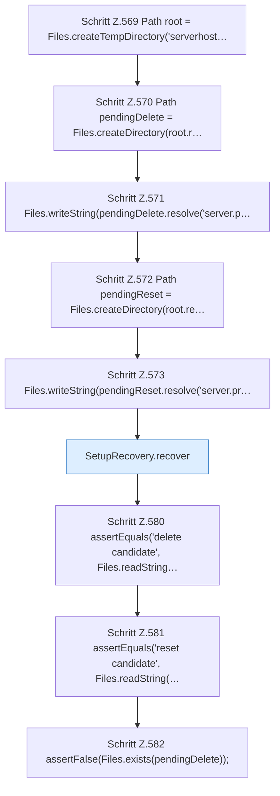

[[00 Start]] › [[Tests]] › [[HosterTest]] › [[HosterTest.Teil4]] › [[HosterTest.setupRecoveryRollsBackPendingDirectoriesBeforeSetupCompletes]] › [[HosterTest.setupRecoveryRollsBackPendingDirectoriesBeforeSetupCompletes.Teil1]]

# HosterTest.setupRecoveryRollsBackPendingDirectoriesBeforeSetupCompletes.Teil1



```knoten
Schritt Z.569 Path root = Files.createTempDirectory('serverhost…
  Zeile 569: Dateioperation. `Path root = Files.createTempDirectory('serverhost…`
Schritt Z.570 Path pendingDelete = Files.createDirectory(root.r…
  Zeile 570: Dateioperation. `Path pendingDelete = Files.createDirectory(root.r…`
Schritt Z.571 Files.writeString(pendingDelete.resolve('server.p…
  Zeile 571: schreibt Text in eine Datei. `Files.writeString(pendingDelete.resolve('server.p…`
Schritt Z.572 Path pendingReset = Files.createDirectory(root.re…
  Zeile 572: Dateioperation. `Path pendingReset = Files.createDirectory(root.re…`
Schritt Z.573 Files.writeString(pendingReset.resolve('server.pr…
  Zeile 573: schreibt Text in eine Datei. `Files.writeString(pendingReset.resolve('server.pr…`
SetupRecovery.recover
  Hebt hängende Zustände auf `recover`.
Schritt Z.580 assertEquals('delete candidate', Files.readString…
  Zeile 580: liest Text aus einer Datei. `assertEquals('delete candidate', Files.readString…`
Schritt Z.581 assertEquals('reset candidate', Files.readString(…
  Zeile 581: liest Text aus einer Datei. `assertEquals('reset candidate', Files.readString(…`
Schritt Z.582 assertFalse(Files.exists(pendingDelete));
  Zeile 582: Dateioperation. `assertFalse(Files.exists(pendingDelete));`
```

- Fortsetzung von `HosterTest.setupRecoveryRollsBackPendingDirectoriesBeforeSetupCompletes`, Quellreihenfolge.
