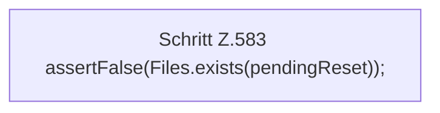

[[00 Start]] › [[Tests]] › [[HosterTest]] › [[HosterTest.Teil4]] › [[HosterTest.setupRecoveryRollsBackPendingDirectoriesBeforeSetupCompletes]] › [[HosterTest.setupRecoveryRollsBackPendingDirectoriesBeforeSetupCompletes.Teil2]]

# HosterTest.setupRecoveryRollsBackPendingDirectoriesBeforeSetupCompletes.Teil2



```knoten
Schritt Z.583 assertFalse(Files.exists(pendingReset));
  Zeile 583: Dateioperation. `assertFalse(Files.exists(pendingReset));`
```

> [!knoten]- Was die Blöcke tun
> - **Schritt Z.583 assertFalse(Files.exists(pendingReset));**: Zeile 583: Dateioperation. `assertFalse(Files.exists(pendingReset));`

- Ein weiterer Abschnitt derselben Übersicht.
- Fortsetzung von `HosterTest.setupRecoveryRollsBackPendingDirectoriesBeforeSetupCompletes`.
