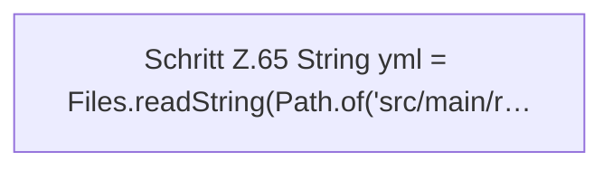

[[00 Start]] › [[Tests]] › [[HosterTest]] › [[HosterTest.Teil1]] › [[HosterTest.singleSlotIsTheDefault]]

# HosterTest.singleSlotIsTheDefault

`HosterTest.singleSlotIsTheDefault()` [src/test/java/de/aichele/childlauncher/HosterTest.java:64–69](https://github.com/Sciddie/minecraft-serverhoster-plugin/blob/95b02b953b0b4c23673e900e021a7c3c844aa37d/src/test/java/de/aichele/childlauncher/HosterTest.java#L64-L69)



```knoten
Schritt Z.65 String yml = Files.readString(Path.of('src/main/r…
  Zeile 65: liest Text aus einer Datei. `String yml = Files.readString(Path.of('src/main/r…`
```

- `singleSlotIsTheDefault` in `src/test/java/de/aichele/childlauncher/HosterTest.java`
- Auslöser: Test
