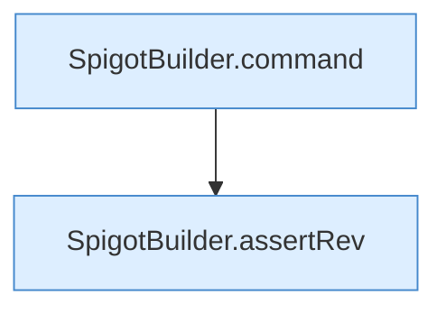

[[00 Start]] › [[Tests]] › [[HosterTest]] › [[HosterTest.Teil3]] › [[HosterTest.spigotCommandIsArgv]]

# HosterTest.spigotCommandIsArgv

`HosterTest.spigotCommandIsArgv()` [src/test/java/de/aichele/childlauncher/HosterTest.java:379–385](https://github.com/Sciddie/minecraft-serverhoster-plugin/blob/95b02b953b0b4c23673e900e021a7c3c844aa37d/src/test/java/de/aichele/childlauncher/HosterTest.java#L379-L385)

- `spigotCommandIsArgv` in `src/test/java/de/aichele/childlauncher/HosterTest.java`
- Auslöser: Test
