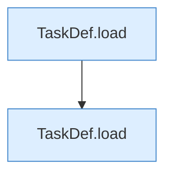

[[00 Start]] › [[Tests]] › [[HosterTest]] › [[HosterTest.Teil2]] › [[HosterTest.tasksParse]]

# HosterTest.tasksParse

`HosterTest.tasksParse()` [src/test/java/de/aichele/childlauncher/HosterTest.java:223–230](https://github.com/Sciddie/minecraft-serverhoster-plugin/blob/95b02b953b0b4c23673e900e021a7c3c844aa37d/src/test/java/de/aichele/childlauncher/HosterTest.java#L223-L230)



```knoten
TaskDef.load
  Dieser Teil lädt das. Lädt `load`. Ruft `str`, `TaskDef`.
```

> [!knoten]- Was die Blöcke tun
> - **TaskDef.load**: Dieser Teil lädt das. Lädt `load`. Ruft `str`, `TaskDef`.

- Ein Schritt in einem [[Glossar#Probelauf|Probelauf]]. Er gehört nicht zum laufenden Server.
- `tasksParse` in `src/test/java/de/aichele/childlauncher/HosterTest.java`
- Das ist ein Probelauf, kein Teil des laufenden Servers.
