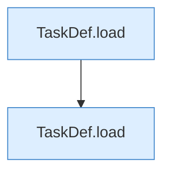

[[00 Start]] › [[Tests]] › [[HosterTest]] › [[HosterTest.Teil2]] › [[HosterTest.tasksParse]]

# HosterTest.tasksParse

`HosterTest.tasksParse()` [src/test/java/de/aichele/childlauncher/HosterTest.java:223–230](https://github.com/Sciddie/minecraft-serverhoster-plugin/blob/95b02b953b0b4c23673e900e021a7c3c844aa37d/src/test/java/de/aichele/childlauncher/HosterTest.java#L223-L230)



```knoten
TaskDef.load
  Lädt `load`. Ruft `str`, `TaskDef`.
```

- `tasksParse` in `src/test/java/de/aichele/childlauncher/HosterTest.java`
- Auslöser: Test
