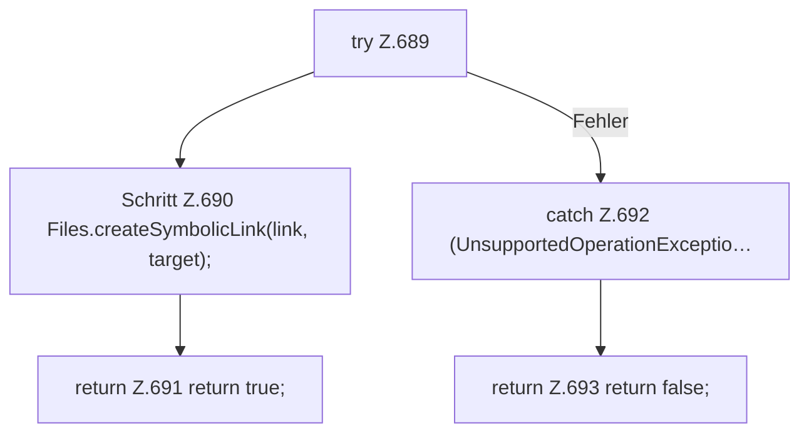

[[00 Start]] › [[Tests]] › [[HosterTest]] › [[HosterTest.Teil5]] › [[HosterTest.tryCreateSymbolicLink]]

# HosterTest.tryCreateSymbolicLink

`HosterTest.tryCreateSymbolicLink(Path link, Path target)` [src/test/java/de/aichele/childlauncher/HosterTest.java:688–695](https://github.com/Sciddie/minecraft-serverhoster-plugin/blob/95b02b953b0b4c23673e900e021a7c3c844aa37d/src/test/java/de/aichele/childlauncher/HosterTest.java#L688-L695)

- `tryCreateSymbolicLink` in `src/test/java/de/aichele/childlauncher/HosterTest.java`
- Auslöser: Test
