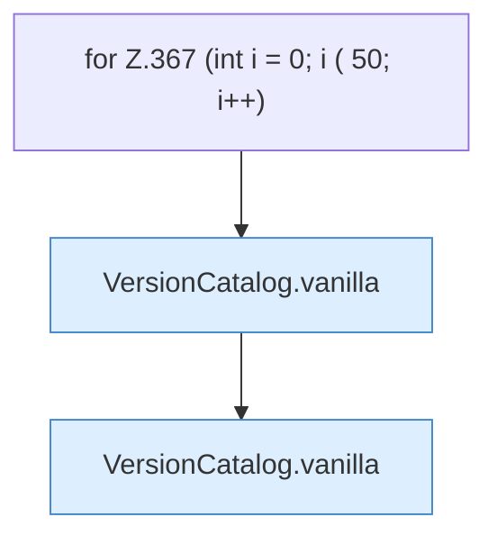

[[00 Start]] › [[Tests]] › [[HosterTest]] › [[HosterTest.Teil3]] › [[HosterTest.versionCatalogCanIncludeMoreThanFortyReleases]]

# HosterTest.versionCatalogCanIncludeMoreThanFortyReleases

`HosterTest.versionCatalogCanIncludeMoreThanFortyReleases()` [src/test/java/de/aichele/childlauncher/HosterTest.java:365–377](https://github.com/Sciddie/minecraft-serverhoster-plugin/blob/95b02b953b0b4c23673e900e021a7c3c844aa37d/src/test/java/de/aichele/childlauncher/HosterTest.java#L365-L377)



```knoten
for Z.367 (int i = 0; i ( 50; i++)
  Zeile 367: Schleife `(int i = 0; i ( 50; i++)`.
VersionCatalog.vanilla
  `vanilla` in `VersionCatalog.java`. Ruft `str`.
```

- `versionCatalogCanIncludeMoreThanFortyReleases` in `src/test/java/de/aichele/childlauncher/HosterTest.java`
- Auslöser: Test
