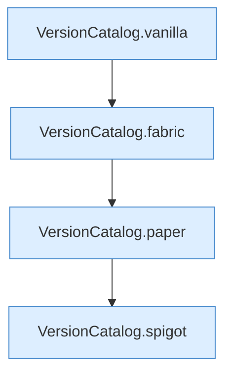

[[00 Start]] › [[Tests]] › [[HosterTest]] › [[HosterTest.Teil3]] › [[HosterTest.versionParsers]] › [[HosterTest.versionParsers.Teil1]]

# HosterTest.versionParsers.Teil1



```knoten
VersionCatalog.vanilla
  `vanilla` in `VersionCatalog.java`. Ruft `str`.
VersionCatalog.fabric
  `fabric` in `VersionCatalog.java`. Ruft `str`.
VersionCatalog.paper
  `paper` in `VersionCatalog.java`.
VersionCatalog.spigot
  `spigot` in `VersionCatalog.java`. Ruft `compare`.
```

- Fortsetzung von `HosterTest.versionParsers`, Quellreihenfolge.
