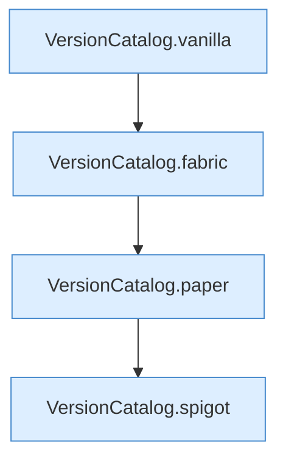

[[00 Start]] › [[Tests]] › [[HosterTest]] › [[HosterTest.Teil3]] › [[HosterTest.versionParsers]] › [[HosterTest.versionParsers.Teil1]]

# HosterTest.versionParsers.Teil1



```knoten
VersionCatalog.vanilla
  Dieser Teil macht hier einen einzelnen Schritt. Eine Ebene tiefer steht er genauer. `vanilla` in `VersionCatalog.java`. Ruft `str`.
VersionCatalog.fabric
  Dieser Teil macht hier einen einzelnen Schritt. Eine Ebene tiefer steht er genauer. `fabric` in `VersionCatalog.java`. Ruft `str`.
VersionCatalog.paper
  Dieser Teil macht hier einen einzelnen Schritt. Eine Ebene tiefer steht er genauer. `paper` in `VersionCatalog.java`.
VersionCatalog.spigot
  Dieser Teil macht hier einen einzelnen Schritt. Eine Ebene tiefer steht er genauer. `spigot` in `VersionCatalog.java`. Ruft `compare`.
```

> [!knoten]- Was die Blöcke tun
> - **VersionCatalog.vanilla**: Dieser Teil macht hier einen einzelnen Schritt. Eine Ebene tiefer steht er genauer. `vanilla` in `VersionCatalog.java`. Ruft `str`.
> - **VersionCatalog.fabric**: Dieser Teil macht hier einen einzelnen Schritt. Eine Ebene tiefer steht er genauer. `fabric` in `VersionCatalog.java`. Ruft `str`.
> - **VersionCatalog.paper**: Dieser Teil macht hier einen einzelnen Schritt. Eine Ebene tiefer steht er genauer. `paper` in `VersionCatalog.java`.
> - **VersionCatalog.spigot**: Dieser Teil macht hier einen einzelnen Schritt. Eine Ebene tiefer steht er genauer. `spigot` in `VersionCatalog.java`. Ruft `compare`.

- Ein weiterer Abschnitt derselben Übersicht.
- Fortsetzung von `HosterTest.versionParsers`.
