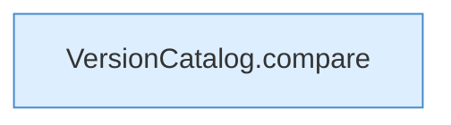

[[00 Start]] › [[Tests]] › [[HosterTest]] › [[HosterTest.Teil3]] › [[HosterTest.versionParsers]] › [[HosterTest.versionParsers.Teil2]]

# HosterTest.versionParsers.Teil2



```knoten
VersionCatalog.compare
  Vergleicht `compare`. Ruft `num`.
```

- Fortsetzung von `HosterTest.versionParsers`, Quellreihenfolge.
