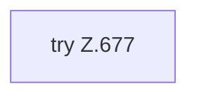

[[00 Start]] › [[Tests]] › [[HosterTest]] › [[HosterTest.Teil5]] › [[HosterTest.writeLegacyPluginJar]]

# HosterTest.writeLegacyPluginJar

`HosterTest.writeLegacyPluginJar(Path jar, String version)` [src/test/java/de/aichele/childlauncher/HosterTest.java:676–682](https://github.com/Sciddie/minecraft-serverhoster-plugin/blob/95b02b953b0b4c23673e900e021a7c3c844aa37d/src/test/java/de/aichele/childlauncher/HosterTest.java#L676-L682)



```knoten
try Z.677
  Zeile 677: Versuch. Der Fehlerpfad geht in catch.
```

- `writeLegacyPluginJar` in `src/test/java/de/aichele/childlauncher/HosterTest.java`
- Auslöser: Test
