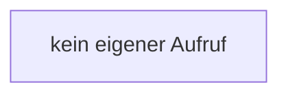

[[00 Start]] › [[Dashboard-HTTP]] › [[HTTP-Klassen]] › [[HttpsSupport]] › [[HttpsSupport.Teil1]] › [[HttpsSupport.HttpsSupport]]

# HttpsSupport.HttpsSupport

`HttpsSupport.HttpsSupport()` [src/main/java/de/aichele/childlauncher/HttpsSupport.java:37–37](https://github.com/Sciddie/minecraft-serverhoster-plugin/blob/95b02b953b0b4c23673e900e021a7c3c844aa37d/src/main/java/de/aichele/childlauncher/HttpsSupport.java#L37-L37)



```knoten
kein eigener Aufruf
  In diesem Stück gibt es keinen weiteren eigenen Aufruf.
```

> [!knoten]- Was die Blöcke tun
> - **kein eigener Aufruf**: In diesem Stück gibt es keinen weiteren eigenen Aufruf.

- Dieser Teil kümmert sich um die Hilfe.
- `HttpsSupport` in `src/main/java/de/aichele/childlauncher/HttpsSupport.java`
