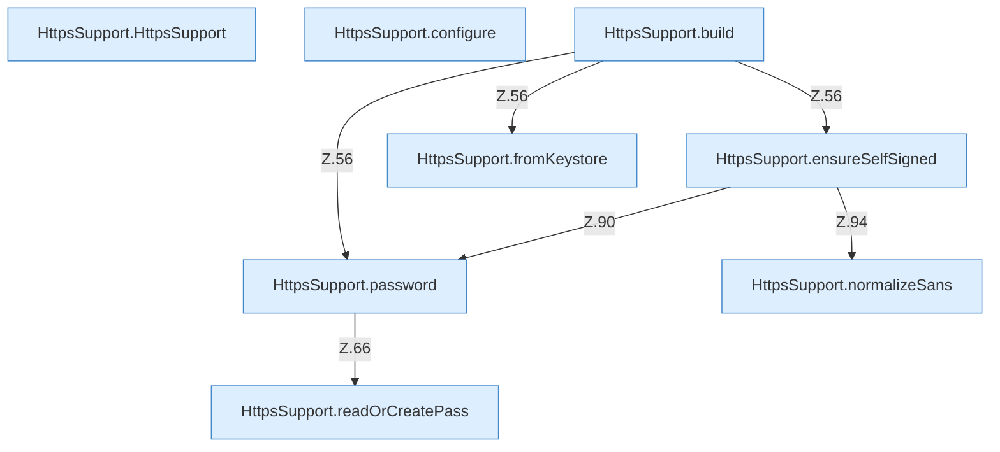

[[00 Start]] › [[Dashboard-HTTP]] › [[HTTP-Klassen]] › [[HttpsSupport]] › [[HttpsSupport.Teil1]]

# HttpsSupport.Teil1



```knoten
HttpsSupport.HttpsSupport
  Dieser Teil kümmert sich um die Hilfe. `HttpsSupport` in `HttpsSupport.java`.
HttpsSupport.configure
  Dieser Teil macht hier einen einzelnen Schritt. Eine Ebene tiefer steht er genauer. `configure` in `HttpsSupport.java`. Ruft `configure`.
HttpsSupport.build
  Dieser Teil baut das. Baut `build`. Ruft `fromKeystore`, `ensureSelfSigned`, `password`.
HttpsSupport.password
  Dieser Teil macht hier einen einzelnen Schritt. Eine Ebene tiefer steht er genauer. `password` in `HttpsSupport.java`. Ruft `readOrCreatePass`.
HttpsSupport.readOrCreatePass
  Dieser Teil liest oder den Ersatz. Liest `readOrCreatePass`.
HttpsSupport.ensureSelfSigned
  Dieser Teil macht hier einen einzelnen Schritt. Eine Ebene tiefer steht er genauer. Stellt sicher `ensureSelfSigned`. Ruft `resolve`, `password`, `normalizeSans`.
HttpsSupport.normalizeSans
  Dieser Teil macht hier einen einzelnen Schritt. Eine Ebene tiefer steht er genauer. Vereinheitlicht `normalizeSans`.
HttpsSupport.fromKeystore
  Dieser Teil macht hier einen einzelnen Schritt. Eine Ebene tiefer steht er genauer. `fromKeystore` in `HttpsSupport.java`.
```

> [!knoten]- Was die Blöcke tun
> - **HttpsSupport.HttpsSupport**: Dieser Teil kümmert sich um die Hilfe. `HttpsSupport` in `HttpsSupport.java`.
> - **HttpsSupport.configure**: Dieser Teil macht hier einen einzelnen Schritt. Eine Ebene tiefer steht er genauer. `configure` in `HttpsSupport.java`. Ruft `configure`.
> - **HttpsSupport.build**: Dieser Teil baut das. Baut `build`. Ruft `fromKeystore`, `ensureSelfSigned`, `password`.
> - **HttpsSupport.password**: Dieser Teil macht hier einen einzelnen Schritt. Eine Ebene tiefer steht er genauer. `password` in `HttpsSupport.java`. Ruft `readOrCreatePass`.
> - **HttpsSupport.readOrCreatePass**: Dieser Teil liest oder den Ersatz. Liest `readOrCreatePass`.
> - **HttpsSupport.ensureSelfSigned**: Dieser Teil macht hier einen einzelnen Schritt. Eine Ebene tiefer steht er genauer. Stellt sicher `ensureSelfSigned`. Ruft `resolve`, `password`, `normalizeSans`.
> - **HttpsSupport.normalizeSans**: Dieser Teil macht hier einen einzelnen Schritt. Eine Ebene tiefer steht er genauer. Vereinheitlicht `normalizeSans`.
> - **HttpsSupport.fromKeystore**: Dieser Teil macht hier einen einzelnen Schritt. Eine Ebene tiefer steht er genauer. `fromKeystore` in `HttpsSupport.java`.

- Ein weiterer Abschnitt derselben Übersicht.
