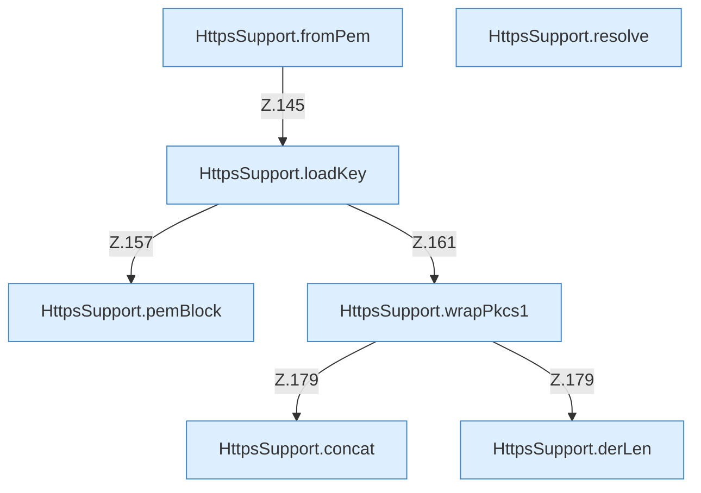

[[00 Start]] › [[Dashboard-HTTP]] › [[HTTP-Klassen]] › [[HttpsSupport]] › [[HttpsSupport.Teil2]]

# HttpsSupport.Teil2



```knoten
HttpsSupport.fromPem
  Dieser Teil macht hier einen einzelnen Schritt. Eine Ebene tiefer steht er genauer. `fromPem` in `HttpsSupport.java`. Ruft `loadKey`.
HttpsSupport.loadKey
  Dieser Teil lädt hier einen Schritt. Eine Ebene tiefer steht er genauer. Lädt `loadKey`. Ruft `pemBlock`, `wrapPkcs1`.
HttpsSupport.pemBlock
  Dieser Teil macht hier einen einzelnen Schritt. Eine Ebene tiefer steht er genauer. `pemBlock` in `HttpsSupport.java`.
HttpsSupport.wrapPkcs1
  Dieser Teil macht hier einen einzelnen Schritt. Eine Ebene tiefer steht er genauer. Hüllt ein `wrapPkcs1`. Ruft `concat`, `derLen`.
HttpsSupport.derLen
  Dieser Teil macht hier einen einzelnen Schritt. Eine Ebene tiefer steht er genauer. `derLen` in `HttpsSupport.java`.
HttpsSupport.concat
  Dieser Teil macht hier einen einzelnen Schritt. Eine Ebene tiefer steht er genauer. `concat` in `HttpsSupport.java`.
HttpsSupport.resolve
  Dieser Teil bestimmt das. Löst auf `resolve`.
```

> [!knoten]- Was die Blöcke tun
> - **HttpsSupport.fromPem**: Dieser Teil macht hier einen einzelnen Schritt. Eine Ebene tiefer steht er genauer. `fromPem` in `HttpsSupport.java`. Ruft `loadKey`.
> - **HttpsSupport.loadKey**: Dieser Teil lädt hier einen Schritt. Eine Ebene tiefer steht er genauer. Lädt `loadKey`. Ruft `pemBlock`, `wrapPkcs1`.
> - **HttpsSupport.pemBlock**: Dieser Teil macht hier einen einzelnen Schritt. Eine Ebene tiefer steht er genauer. `pemBlock` in `HttpsSupport.java`.
> - **HttpsSupport.wrapPkcs1**: Dieser Teil macht hier einen einzelnen Schritt. Eine Ebene tiefer steht er genauer. Hüllt ein `wrapPkcs1`. Ruft `concat`, `derLen`.
> - **HttpsSupport.derLen**: Dieser Teil macht hier einen einzelnen Schritt. Eine Ebene tiefer steht er genauer. `derLen` in `HttpsSupport.java`.
> - **HttpsSupport.concat**: Dieser Teil macht hier einen einzelnen Schritt. Eine Ebene tiefer steht er genauer. `concat` in `HttpsSupport.java`.
> - **HttpsSupport.resolve**: Dieser Teil bestimmt das. Löst auf `resolve`.

- Ein weiterer Abschnitt derselben Übersicht.
