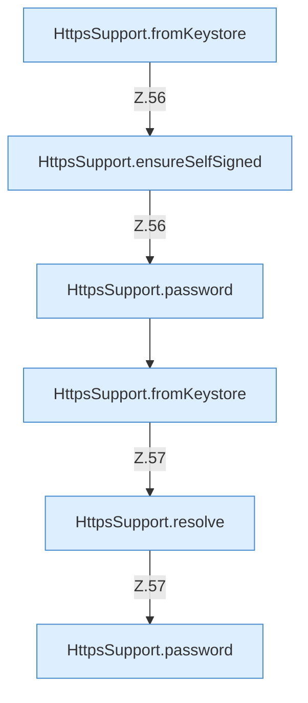

[[00 Start]] › [[Dashboard-HTTP]] › [[HTTP-Klassen]] › [[HttpsSupport]] › [[HttpsSupport.Teil1]] › [[HttpsSupport.build]] › [[HttpsSupport.build.Z55.Teil1]]

# HttpsSupport.build.Z55.Teil1



```knoten
HttpsSupport.fromKeystore
  `fromKeystore` in `HttpsSupport.java`.
HttpsSupport.ensureSelfSigned
  Stellt sicher `ensureSelfSigned`. Ruft `resolve`, `password`, `normalizeSans`.
HttpsSupport.password
  `password` in `HttpsSupport.java`. Ruft `readOrCreatePass`.
HttpsSupport.resolve
  Löst auf `resolve`.
```

- Fortsetzung von `HttpsSupport.build.Z55`, Quellreihenfolge.
