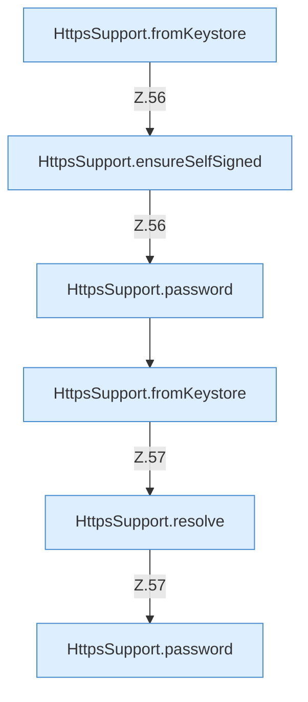

[[00 Start]] › [[Dashboard-HTTP]] › [[HTTP-Klassen]] › [[HttpsSupport]] › [[HttpsSupport.Teil1]] › [[HttpsSupport.build]] › [[HttpsSupport.build.Z55.Teil1]]

# HttpsSupport.build.Z55.Teil1



```knoten
HttpsSupport.fromKeystore
  Dieser Teil macht hier einen einzelnen Schritt. Eine Ebene tiefer steht er genauer. `fromKeystore` in `HttpsSupport.java`.
HttpsSupport.ensureSelfSigned
  Dieser Teil macht hier einen einzelnen Schritt. Eine Ebene tiefer steht er genauer. Stellt sicher `ensureSelfSigned`. Ruft `resolve`, `password`, `normalizeSans`.
HttpsSupport.password
  Dieser Teil macht hier einen einzelnen Schritt. Eine Ebene tiefer steht er genauer. `password` in `HttpsSupport.java`. Ruft `readOrCreatePass`.
HttpsSupport.resolve
  Dieser Teil bestimmt das. Löst auf `resolve`.
```

> [!knoten]- Was die Blöcke tun
> - **HttpsSupport.fromKeystore**: Dieser Teil macht hier einen einzelnen Schritt. Eine Ebene tiefer steht er genauer. `fromKeystore` in `HttpsSupport.java`.
> - **HttpsSupport.ensureSelfSigned**: Dieser Teil macht hier einen einzelnen Schritt. Eine Ebene tiefer steht er genauer. Stellt sicher `ensureSelfSigned`. Ruft `resolve`, `password`, `normalizeSans`.
> - **HttpsSupport.password**: Dieser Teil macht hier einen einzelnen Schritt. Eine Ebene tiefer steht er genauer. `password` in `HttpsSupport.java`. Ruft `readOrCreatePass`.
> - **HttpsSupport.resolve**: Dieser Teil bestimmt das. Löst auf `resolve`.

- Ein weiterer Abschnitt derselben Übersicht.
- Fortsetzung von `HttpsSupport.build.Z55`.
