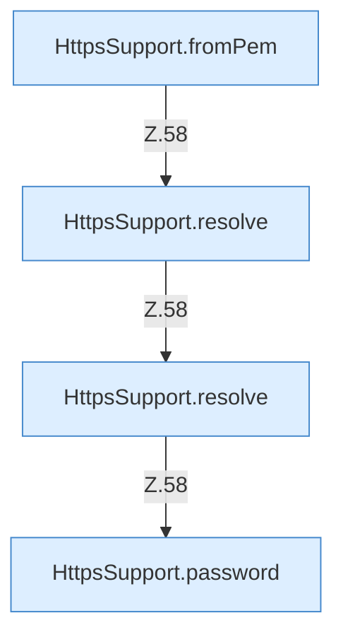

[[00 Start]] › [[Dashboard-HTTP]] › [[HTTP-Klassen]] › [[HttpsSupport]] › [[HttpsSupport.Teil1]] › [[HttpsSupport.build]] › [[HttpsSupport.build.Z55.Teil2]]

# HttpsSupport.build.Z55.Teil2



```knoten
HttpsSupport.fromPem
  Dieser Teil macht hier einen einzelnen Schritt. Eine Ebene tiefer steht er genauer. `fromPem` in `HttpsSupport.java`. Ruft `loadKey`.
HttpsSupport.resolve
  Dieser Teil bestimmt das. Löst auf `resolve`.
HttpsSupport.password
  Dieser Teil macht hier einen einzelnen Schritt. Eine Ebene tiefer steht er genauer. `password` in `HttpsSupport.java`. Ruft `readOrCreatePass`.
```

> [!knoten]- Was die Blöcke tun
> - **HttpsSupport.fromPem**: Dieser Teil macht hier einen einzelnen Schritt. Eine Ebene tiefer steht er genauer. `fromPem` in `HttpsSupport.java`. Ruft `loadKey`.
> - **HttpsSupport.resolve**: Dieser Teil bestimmt das. Löst auf `resolve`.
> - **HttpsSupport.password**: Dieser Teil macht hier einen einzelnen Schritt. Eine Ebene tiefer steht er genauer. `password` in `HttpsSupport.java`. Ruft `readOrCreatePass`.

- Ein weiterer Abschnitt derselben Übersicht.
- Fortsetzung von `HttpsSupport.build.Z55`.
