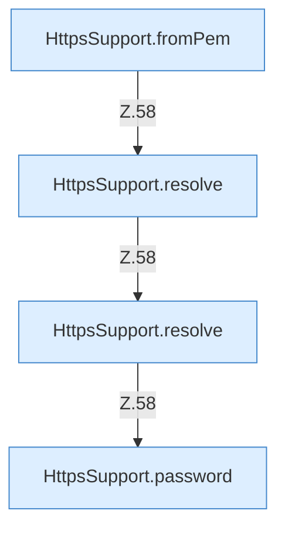

[[00 Start]] › [[Dashboard-HTTP]] › [[HTTP-Klassen]] › [[HttpsSupport]] › [[HttpsSupport.Teil1]] › [[HttpsSupport.build]] › [[HttpsSupport.build.Z55.Teil2]]

# HttpsSupport.build.Z55.Teil2

- Fortsetzung von `HttpsSupport.build.Z55`, Quellreihenfolge.
