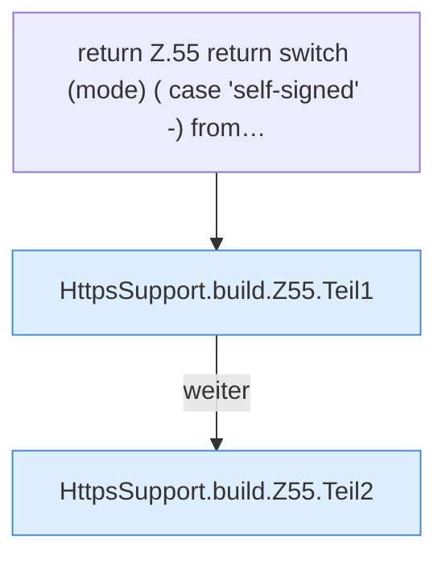

[[00 Start]] › [[Dashboard-HTTP]] › [[HTTP-Klassen]] › [[HttpsSupport]] › [[HttpsSupport.Teil1]] › [[HttpsSupport.build]] › [[HttpsSupport.build.Z55]]

# HttpsSupport.build.Z55



```knoten
return Z.55 return switch (mode) ( case 'self-signed' -) from…
  Zeile 55: Rückgabe `return switch (mode) ( case 'self-signed' -) from…`.
HttpsSupport.build.Z55.Teil1
  Abschnitt 1 dieses Ablaufs, in Quellreihenfolge.
HttpsSupport.build.Z55.Teil2
  Abschnitt 2 dieses Ablaufs, in Quellreihenfolge.
```

- Fortsetzung von `HttpsSupport.build`, Quellreihenfolge.
