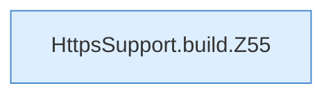

[[00 Start]] › [[Dashboard-HTTP]] › [[HTTP-Klassen]] › [[HttpsSupport]] › [[HttpsSupport.Teil1]] › [[HttpsSupport.build]]

# HttpsSupport.build

`HttpsSupport.build(Path dataDir, Spec spec, Consumer<String> log)` [src/main/java/de/aichele/childlauncher/HttpsSupport.java:53–61](https://github.com/Sciddie/minecraft-serverhoster-plugin/blob/95b02b953b0b4c23673e900e021a7c3c844aa37d/src/main/java/de/aichele/childlauncher/HttpsSupport.java#L53-L61)



```knoten
HttpsSupport.build.Z55
  Der Ablauf geht in [[Glossar#Zeile|Zeile]] 55 weiter. Eine Ebene tiefer steht er genauer. Fortsetzung des Ablaufs ab Zeile 55.
```

> [!knoten]- Was die Blöcke tun
> - **HttpsSupport.build.Z55**: Der Ablauf geht in [[Glossar#Zeile|Zeile]] 55 weiter. Eine Ebene tiefer steht er genauer. Fortsetzung des Ablaufs ab Zeile 55.

- Dieser Teil baut das.
- `build` in `src/main/java/de/aichele/childlauncher/HttpsSupport.java`
